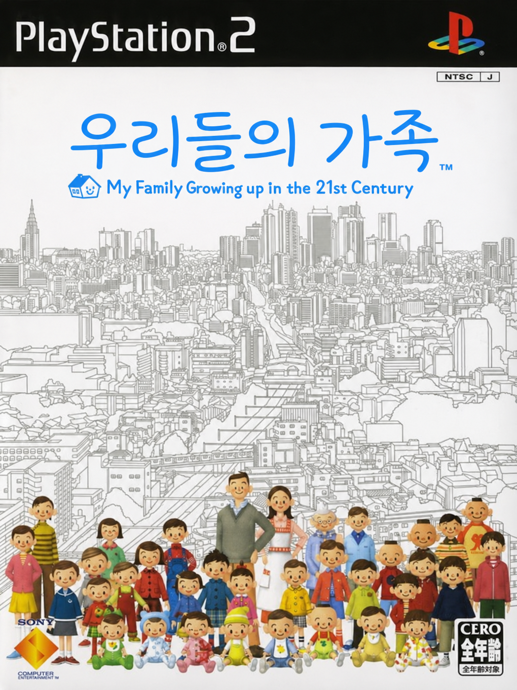

<p align="center"></p>

# 우리들의 가족 한글패치 (ぼくらの家族 Korean Patch)

PS2 일본판 **ぼくらの家族 (SCPS-15088)** 를 한국어로 옮기는 팬 번역 프로젝트입니다.
게임 이미지를 직접 고치지 않고, 원본 ISO에서 매번 같은 결과를 만들어 내는 빌드 스크립트와 번역 데이터를 관리합니다.

> **현재 상태: 베타 v0.9.0-beta.1 (내부 플레이 테스트 중).** 대사·메뉴·데이터 전체 번역과 검수, 그림 글자·동영상 제목 교체까지 끝났습니다. 게임 끝까지 이어서 해 보는 확인은 아직입니다.

## 진행 상황 (2026-11-11)

### 배포 상태: **베타 v0.9.0-beta.1 (`--policy beta`)**

| 판단 기준 | 상태 |
|---|---|
| 번역 | 대사 4,478블록 · 시스템 메시지 60 · 시스템 텍스트 2,461줄 전부 번역. 번역·검수 모두 Claude(D1), 원문과 대조하는 독립 검수를 한 번 거침(고친 줄 214). 사람의 문장별 검수는 하지 않음 |
| 그림 글자 | 타이틀 로고, 메뉴 아이콘 7, 미니게임 그림 15, 책 표지 61, 앨범 사진 라벨 113 |
| 동영상 | 오프닝 제목, 엔딩 15종 제목 카드(D9). 스태프 크레딧은 원본 유지 |
| 진행을 막는 결함 | 알려진 결함 없음 |
| 실행 확인 | PCSX2에서 타이틀 → 새 게임 → 이름 입력 → 오프닝 → 프롤로그 → 첫 아이 출생 → 첫 행동 메뉴까지 확인. 엔딩은 게임 안에서 재생해 보지 않음. 실기 확인 안 함 |

### 진행률 (대략)

| 영역 | 진행률 | 내용 |
|---|---|---|
| 번역·검수 | 100% | 대사·메뉴·데이터·이름 목록, 입학시험 퀴즈 289문항 새 출제(D8) |
| 기술 작업 | 약 95% | 한글 폰트, 세로쓰기 대사, 자모 조합 이름 입력, 이름 뒤 조사 자동 선택, 반 칸 띄어쓰기, 그림·동영상 교체, 재현 빌드 |
| 런타임 확인 | 약 30% | 초반부만 확인. 정보 상자 줄바꿈, 미니게임, 엔딩은 아직 |
| 배포 준비 | 90% | 베타 묶음 생성·Linux 적용 검증. 배포처 미정 |

### 남은 작업

1. **플레이 테스트** — 정보 상자(책·학교·직업) 글자 넘침, `%s째 아이` 등 표기, 미니게임 5종, 엔딩 동영상
2. **책 표지 다듬기** — 붓글씨 제목 표지 10여 장은 넓은 단색 판이 그림을 가림(지우기를 인페인팅으로 바꾸면 개선)
3. **메뉴 일부 공백** — 글자 크기 코드가 없는 메뉴 문자열은 아직 공백이 한 칸 너비
4. Windows 적용 스크립트를 실제 Windows에서 확인, 실기 확인(가능하면)

## 패치 적용 방법

배포 zip(`BokuraNoKazoku-Korean-Patch-v<버전>.zip`)을 받아 완전히 풉니다. zip 안의 `읽어주세요.txt`에도 같은 안내가 있습니다.

### 1. 원본 ISO

패치는 일본판 **SCPS-15088** ISO 한 가지에만 맞습니다. 적용 스크립트가 SHA1을 확인하며, 다른 판이면 아무 파일도 만들지 않습니다.

```
f2a8187457148a66fbbb3841032fe430cb5572d4  Bokura no Kazoku - My Family Growing Up in the 21st Century (Japan).iso
```

### 2. 적용

- **Windows**: 원본 ISO를 `한글패치_적용.bat` 위에 끌어다 놓습니다(또는 원본 ISO를 같은 폴더에 넣고 더블클릭). 함께 든 `tools/xdelta3decode.exe`(xdelta 3.2.2 공식 배포본)를 씁니다.
- **Linux / macOS**: `xdelta3`를 설치하고(`sudo apt install xdelta3`, `brew install xdelta`) 실행합니다.

  ```bash
  sh apply.sh "Bokura no Kazoku (Japan).iso"
  ```

- **다른 도구**: `patch/Kazoku-ko.xdelta`는 표준 xdelta3(VCDIFF)라 xdelta UI·Delta Patcher로도 적용됩니다.

원본 ISO는 바뀌지 않고, 같은 폴더에 한글판 ISO(`BokuraNoKazoku_KR_v<버전>.iso`, 약 2.1GB)가 새로 생깁니다.

### 3. 실행

- PCSX2 등 에뮬레이터에서 한글판 ISO를 엽니다.
- 대사는 원작처럼 **세로쓰기**입니다.
- 이름은 한글 자모를 하나씩 눌러 조합합니다(ㄱ ㅣ ㅁ → 김). 조합되는 글자는 완성형(KS X 1001) 2,350자이고, ×로 자모 단위로 지웁니다.
- 음성은 일본어 원본 그대로입니다.

## 한글화 범위

| 대상 | 내용 |
|---|---|
| 대사 | 이벤트 대사 1,517파일 4,478블록, 세로쓰기 유지(D5), 띄어쓰기는 반 칸 |
| 시스템 | 메뉴·설정·안내, 학교·책·직업·동아리·아르바이트 데이터, 가족 뉴스, 메모리 카드 안내 |
| 이름 | 기본 이름 목록 음역(D7: 일본식 음역 유지 — 치코, 모크, 사쿠라다 사쿠타로 …), 자모 조합 입력(D6), 이름 뒤 조사 자동 선택 |
| 미니게임 | 화면 문구·그림, 입학시험 문제는 한국어 문제로 새로 출제(D8) |
| 그림 | 타이틀 로고 「우리들의 가족」, 메뉴 아이콘, 책 표지, 앨범 사진 라벨 |
| 동영상 | 오프닝 제목, 엔딩 제목 카드 15종 |

### 일본어로 남는 것 (승인된 예외)

- 오프닝·엔딩 동영상의 스태프 크레딧 (D9)
- 메뉴 소개 화면 배경 사진의 간판 등 (D10, 도쿄 배경 유지)
- 책 표지의 작은 저자·출판사 표기
- 메모리 카드 저장 이름 (PS2 본체 화면이 한글을 표시하지 못함)

## 기술 요약

| 항목 | 방법 |
|---|---|
| 압축·아카이브 | XAPF 아카이브와 LZ 압축을 Python으로 옮김(`tools/xap.py`, `tools/xaplz.py`), 원본과 바이트 단위 왕복 |
| 글꼴 | 한자 코드 영역(0x889F~)에 KS X 1001 한글 2,350자 + 자모 51자, Noto Sans CJK로 그림(`tools/font20.py`, `tools/hangul_map.py`) |
| 대사 | 실행 파일 로더(0x13DA10) 규칙대로 추출·검사·재삽입(`tools/mes.py`): 음성 구간 쉼표, 주석, 줄·본문 바이트, 세로 19칸 |
| 띄어쓰기 | `@sNN`이 글자 크기임을 확인 → 공백만 반 크기로(`@s10 @s20`) |
| 이름 입력 | `CMenuInputKanji`에 MIPS 훅 3곳, 자모 조합 코드는 Python 기준 구현과 Unicorn으로 대조(`tools/ime_asm.py`, `tools/elfpatch.py`) |
| 조사 | 이름 변수 확장 직후 훅(0x13E4C8): 번역문의 `은（는）` 꼴을 이름 끝 받침에 맞춰 하나로 |
| 그림 | TIM2 재인코딩(원본 팔레트 유지), 영역별 한글 렌더 사양 `text/gfx_ko.json`, 로고는 인페인팅 후 생성 |
| 동영상 | 제목 구간 GOP만 다시 인코딩해 0바이트 채움으로 같은 길이로 끼움 → 나머지 영상·오디오·타임스탬프는 원본 그대로(`tools/pss.py`, `tools/movie_title.py`) |

## 빌드

원본 ISO는 저장소에 넣지 않습니다. `work/orig.iso`에 원본을 두고(심볼릭 링크 가능):

```bash
python3 -m venv .venv && .venv/bin/pip install pillow keystone-engine opencv-python-headless numpy pytest unicorn capstone
.venv/bin/python tools/unpack_all.py            # work/unpacked (추출 기준 확인용)
.venv/bin/python tools/build_movies.py work/orig.iso work/movie_ko
.venv/bin/python tools/build_patch.py work/orig.iso work/build/beta.iso --policy beta
.venv/bin/python -m pytest -q tests/
```

배포 묶음 만들기와 정책(`dev`/`beta`/`release`)은 [docs/release.md](docs/release.md)를 보세요. `ffmpeg`, `xdelta3`가 필요합니다.

## 저장소 구조

| 경로 | 내용 |
|---|---|
| `text/` | 추출 기준(`*_src.jsonl`), 번역(`*_ko.jsonl`), 용어집(`glossary.json`), 그림 사양(`gfx_ko.json`) |
| `tools/` | 추출·검사·재삽입·빌드·패키징 도구 |
| `tests/` | 단위·왕복·코퍼스 테스트 |
| `docs/` | 조사(`survey.md`), 결정 기록(`decisions.md`, D1–D10), PoC 기록(`poc.md`), 번역 규칙(`translation.md`), 텍스트 지도(`text_map.md`), 그림 글자 카탈로그(`graphics_text.md`), 빌드·배포(`release.md`) |
| `release/` | 배포 묶음 템플릿(적용 스크립트·안내문·고지) |

## 고지

비공식·비상업 팬 번역입니다. 합법적으로 소유한 게임에서만 사용하세요. 패치를 적용한 ISO를 배포하지 마세요.
「ぼくらの家族」과 게임 데이터의 권리는 Sony Interactive Entertainment 및 제작사(밀레니엄 키친)에 있으며, 이 프로젝트는 이들과 관계가 없습니다.
한글 글리프와 그림 속 한글은 Noto Sans CJK(SIL Open Font License 1.1)로 그렸습니다.
